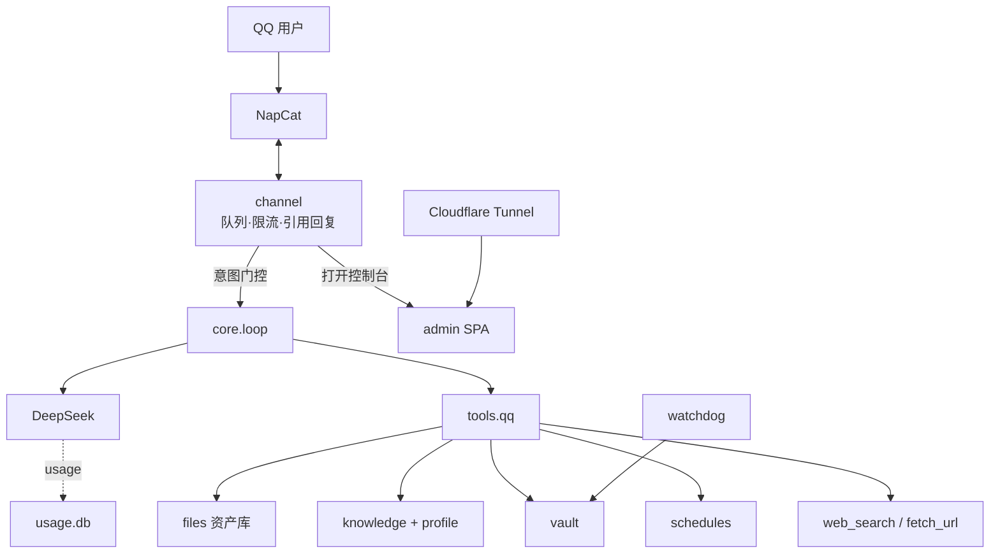

# Tiny QQ Agent（鲸鱼娘）

挂在 QQ 上的 DeepSeek 鲸鱼娘：NapCat / OneBot + 自研 Agent Loop。  
从「能聊天」升级为 **个人知识管理 + 智能文件资产库 + 可视化控制台**。

```text
channel → core → tools.qq
           ├─ knowledge / profile / vault
           ├─ files（智能标签·NL 检索·元数据）
           ├─ schedules + calendar ICS
           ├─ search（联网搜索 / 打开链接）
           └─ admin Dashboard（Magic Link / CRUD）
```

## 快速开始

```bash
pip install -r requirements.txt
pip install fastapi uvicorn itsdangerous watchdog GitPython
pip install httpx fastembed sqlite-vec   # 连接池 + 语义索引（推荐）
# 编辑 agent/.env：API_KEY、QQ_ADMIN_PORT=8787、可选 QQ_VAULT_PATH
python -m agent
```

私聊「打开控制台」→ 公网 Magic Link（Cloudflare Tunnel，手机流量可开）。

## 核心能力

| 模块 | 亮点 |
|------|------|
| 智能文件资产 | LLM 摘要+标签、元数据回执、自然语言「把上次那个 PDF 发我」 |
| 记忆与画像 | 多租户记忆、意图门控、结构化用户画像、对话后静默提炼 |
| Vault | Obsidian 监听入库、AI 写笔记、Git commit |
| 催办 / 日历 | APScheduler 多点催办；「导出日历」生成 ICS |
| 联网 | 统一 httpx 连接池；搜不到/打不开也会口语回应，不装死 |
| 控制台 | 待办/记忆/Vault CRUD、预览下载、手机适配 |
| 可观测 | 结构化日志、Token 用量统计、消息处理队列、发送限流 |
| HTTP / 向量 | httpx 连接池 + `chat_async`；sqlite-vec / BLOB 持久语义索引 |

## 话术示例

```text
打开控制台
把上次那个PDF发我
有哪些文件
帮我搜一下 xxx
写一篇关于异步的笔记
导出日历
用量
记一下 周末爬山
```

## 架构图



## 配置要点

```env
API_KEY=
QQ_ADMIN_PORT=8787
QQ_ADMIN_TUNNEL=cloudflare
# QQ_VAULT_PATH=D:/Obsidian/MyVault
QQ_INTENT_GATE=llm
QQ_FORCE_SEMANTIC=1
QQ_VECTOR_BACKEND=auto
# QQ_FETCH_PROXY=http://127.0.0.1:7890
```

文档：[docs/README.md](docs/README.md) · [功能清单](docs/features.md) · [路线图](docs/roadmap.md) · [Vault/控制台](docs/vault-dashboard.md)

## 刻意不做 / 后置

OneBot 全程 asyncio 重写、Google Calendar OAuth、PDF OCR —— 见路线图 Phase 5。

## License

见仓库许可。
