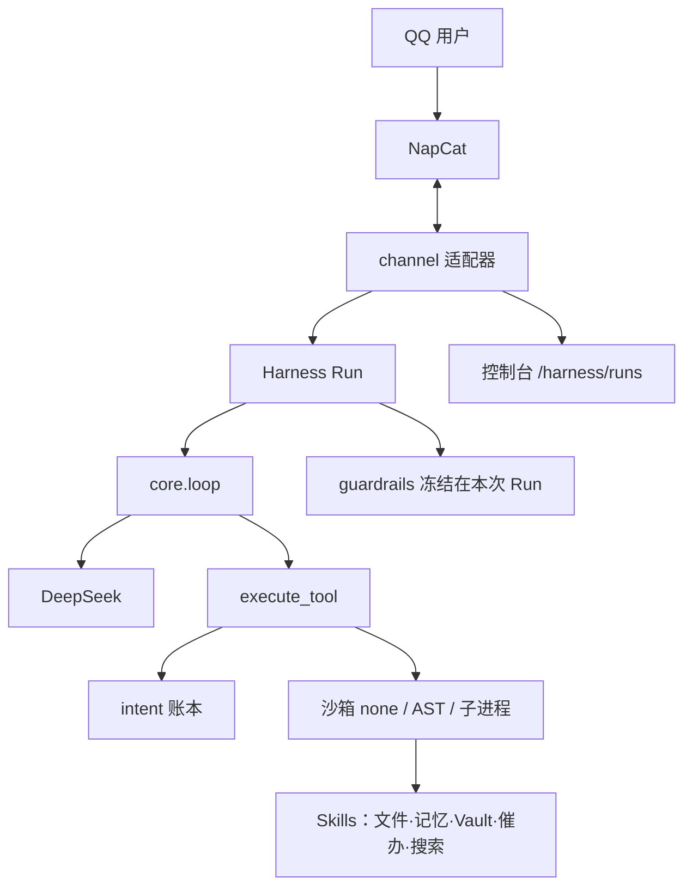

# Tiny QQ Agent（鲸鱼娘）

挂在 QQ 上的 DeepSeek 鲸鱼娘。QQ 只是适配器，核心是一套小型 Agent Harness：Run 状态机、技能契约、intent 账本、可卸载插件、进程沙箱，以及要先过回放对照才能生效的约束。

```text
QQ Adapter → Harness Runtime → Skills
                 ├─ Run / intent 账本 / UNKNOWN 恢复
                 ├─ 注册表（版本快照、引用计数）
                 ├─ 沙箱 none | AST | 子进程
                 └─ guardrails 晋升 / 回滚
```

## 快速开始

```bash
pip install -r requirements.txt
pip install fastapi uvicorn itsdangerous watchdog GitPython
pip install httpx fastembed sqlite-vec   # 连接池 + 语义索引（推荐）
# 编辑 agent/.env：API_KEY、QQ_ADMIN_PORT=8787、可选 QQ_VAULT_PATH
python -m agent
```

私聊「打开控制台」→ 公网 Magic Link（Cloudflare Tunnel，手机流量可开）。

## 核心能力

| 模块 | 亮点 |
|------|------|
| Harness | Run 状态机、副作用账本、UNKNOWN 不自动重做不可逆操作 |
| 插件 | manifest 自描述、按需加载、引用中的版本不能卸 |
| 沙箱 | 不可信脚本进子进程，越权读和对外连接失败，用量进 trace |
| 约束 | 回放对照通过才写入 guardrails，可按快照回滚；执行期会拦住重复的不可逆调用 |
| 文件 / 记忆 / Vault / 催办 | 领域技能，走同一套契约，不是另一套机器人逻辑 |
| 联网 | httpx 连接池；搜不到也会回话 |
| 控制台 | Magic Link、CRUD，以及 `/harness/runs/{id}` |

## 话术示例

```text
打开控制台
把上次那个PDF发我
有哪些文件
帮我搜一下 xxx
写一篇关于异步的笔记
导出日历
用量
记一下 周末爬山
```

## 架构图



## 配置要点

```env
API_KEY=
QQ_ADMIN_PORT=8787
QQ_ADMIN_TUNNEL=cloudflare
# QQ_VAULT_PATH=D:/Obsidian/MyVault
QQ_INTENT_GATE=llm
QQ_FORCE_SEMANTIC=1
QQ_VECTOR_BACKEND=auto
# QQ_FETCH_PROXY=http://127.0.0.1:7890
```

文档：[docs/README.md](docs/README.md) · **[Harness 演进计划](docs/harness-runtime-plan.md)** · [功能清单](docs/features.md) · [路线图](docs/roadmap.md)

## 架构主线

QQ 是 Adapter，Harness 是核心，文件、记忆、催办、搜索、Vault、插件是 Skill。  
Phase 6（Run、账本、契约、沙箱、可回滚约束）已经接在 QQ 消息路径上，见演进计划。

## 刻意不做 / 后置

堆新应用功能、插件市场、Calendar OAuth、PDF OCR、OneBot 全量 asyncio —— 不抢 Runtime 优先级。

## License

见仓库许可。
